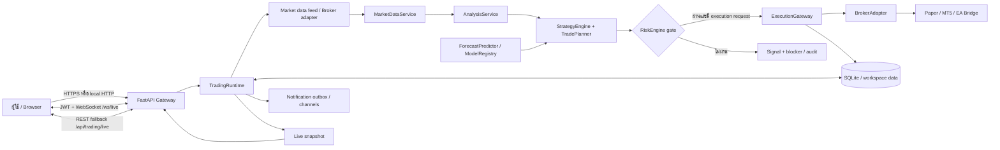
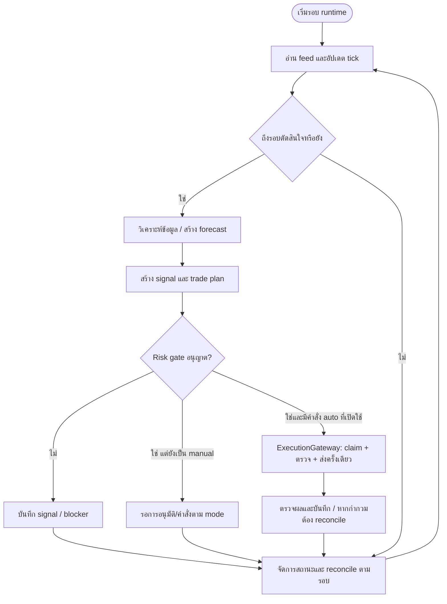

# No7 AI Trading Pro — V1

[](https://github.com/danaikointa-maker/TradeAi/actions/workflows/ci.yml)

แพลตฟอร์มเทรดส่วนตัวแบบ **Local-First + Hybrid Quant AI + Multi-Broker**
รวมกราฟราคาแบบ TradingView, การวิเคราะห์โครงสร้างตลาด, แนวรับ–แนวต้านแบบ confluence,
การพยากรณ์ราคาเป็นช่วงความน่าจะเป็น, สัญญาณ Buy/Sell พร้อม SL/TP, Risk Engine ที่ยับยั้งได้ทุกคำสั่ง
และชั้นส่งคำสั่งที่ทำงานร่วมกับ MT5 (เริ่มที่ **Demo เท่านั้น**)

> **หลักคิด:** ไม่มี AI ตัวไหนทายกราฟถูก 100% ระบบนี้จึงเน้น *วัดผลจริง* —
> เก็บสถิติความแม่นยำแยกตามสภาวะตลาด, บันทึกช่วงที่ระบบ "ไม่ยอมเทรด",
> และยอมให้ Risk Engine ยับยั้ง AI ได้เสมอ
>
> ซอฟต์แวร์นี้เป็นเครื่องมือเพื่อการศึกษา/ทดลอง **ไม่ใช่คำแนะนำการลงทุน**
> ผลทดสอบย้อนหลังไม่รับประกันอนาคต

---

## สถานะปัจจุบัน (V1, บนเครื่องนี้)

**Safety baseline เฟส 1:** ตรวจ source/config และผล local ตาม
[`docs/BASELINE-P1.th.md`](docs/BASELINE-P1.th.md) และ
[`docs/SAFETY-HANDOFF.th.md`](docs/SAFETY-HANDOFF.th.md)
ตารางนี้บอกว่ามี implementation ไม่ใช่ release/MT5/เงินจริง acceptance;
ยังคง single-runtime execution boundary และไม่อนุญาตเปิด execution จากผลทดสอบ local

| ส่วน | สถานะ |
|---|---|
| API Gateway (FastAPI) + JWT + WebSocket | ✅ ทำงาน |
| Market data (simulated feed, seed 7) + MT5 adapter | ✅ / ⏳ ต้องเทอร์มินัล Windows |
| EA bridge (MQL5 poll → API) | มี server/EA source และ historical compile evidence; ยังไม่ผ่าน MT5 crash/restart acceptance |
| นำเข้าข้อมูลจริง (CSV) + ประเมิน offline บนข้อมูลจริง | ✅ `scripts/import_candles.py` (ดู `docs/DATA.md`) |
| Live replay จากข้อมูลที่นำเข้า (`feed_mode: replay`) | ✅ ใช้งานได้ (ยังไม่ใช่ tick data) |
| Trend · Market structure (BOS/CHoCH) · S/R confluence | ✅ |
| Forecast 5/15/30/60/240 นาที + isotonic calibration + P10–P90 | ✅ (บาง horizon ยังไม่ผ่านเกณฑ์ OOS) |
| Signal scoring 0–100 + Risk Gate | ✅ |
| Risk Engine (kill switch, daily/weekly loss, cooldown, spread, news) | ✅ |
| Execution gateway | มี atomic admission สำหรับ connections ที่ใช้ SQLite DB เดียวกัน; ไม่ใช่ multi-host fencing |
| Backtest engine + walk-forward + cost model | ✅ |
| AI Journal / Explainer (deterministic, LLM เป็นตัวเลือก) | ✅ |
| Dashboard (Vue 3 + Tailwind + ECharts + Lightweight Charts) | ✅ 10 หน้า |
| MQL5 EA durable journal + bridge | claim/outcome replay และ fail-closed guards; ไม่รับรอง broker exactly-once หรือ power-loss durability |
| Tick storage รายวัน (parquet, lazy) + intra-bar ordering | ✅ |
| Mobile PWA (ติดตั้งได้, แถบอัปเดต/ออฟไลน์ที่บอกความจริง) | ✅ |
| TLS (uvicorn หรือ reverse proxy) + security headers/CORS allowlist | ✅ |
| Telegram / LINE แจ้งเตือน | ✅ ส่งจริงผ่าน HTTP (retry/pacing/redact) — ยังไม่ทดสอบกับปลายทางจริง |

## Quickstart (Linux/macOS/Windows, ไม่ต้องมี MT5)

### Windows PowerShell: isolated local development

Install Python 3.11+ and Node.js/npm first. From the repository root:

```powershell
powershell -NoProfile -ExecutionPolicy Bypass -File .\scripts\setup-windows.ps1
powershell -NoProfile -ExecutionPolicy Bypass -File .\scripts\check-windows.ps1
powershell -NoProfile -ExecutionPolicy Bypass -File .\scripts\run-local.ps1
```

`Bypass` applies only to that child process; these commands do not change the
machine's execution policy. Review the scripts before running them. Setup uses
the committed npm lockfile (`npm ci`), creates `.venv`, installs the development
requirements, and creates `.env` with a random JWT secret only if it does not
already exist. Dependency failures stop setup rather than silently changing
the required package versions. Existing `.env` files are never overwritten.

The local launcher binds to `127.0.0.1:8000` (override with `-Port 8001`), uses
simulated prices and paper-only broker profiles, disables Full Auto, EA bridge,
external alerts and automatic model training, and isolates runtime files in
ignored `storage/local-dev/`. The standard demo login from `.env.example` applies
unless you changed it in `.env`; never expose this development login publicly.
Stop the process with Ctrl+C. No main-server address or production credential
is needed. Do not use this launcher for live trading or server deployment.

The check script runs `pip check`, Ruff (`F,E9`), pytest and the dashboard build.
In VS Code, use **Terminal > Run Task** and choose `TradeAi: Run local simulation`
or `TradeAi: Check tests and build`. The setup task installs dependencies, so do
not run setup while a build/check task is using `node_modules`. If port 8000 is
already occupied by your local simulation, use that running instance rather than
starting a second one. Stop the foreground local task with Ctrl+C before restarting.
It is intended to run in its own PowerShell process, as shown above, because it
clears inherited `NO7_*`/`MT5_*` variables before tests use temporary storage.
Check results do not certify MT5 operation or profitability.

### Local MT5 Demo read-only diagnostics (no VM required)

This is separate from the paper-only launcher. It does not change broker profiles,
start the trading runtime, log into accounts, or send orders. Install the optional
Windows dependency into the existing virtual environment:

```powershell
.\.venv\Scripts\python.exe -m pip install -r requirements-mt5.txt
```

Open `C:\Program Files\MetaTrader 5\terminal64.exe` yourself and log into the
intended **Demo** account. Check the exact login number, server and symbol in MT5.
Disable unrelated EAs/automation yourself before testing. Then run, substituting
your actual Demo identity (the following values are examples, not credentials):

```powershell
powershell -NoProfile -ExecutionPolicy Bypass -File .\scripts\check-mt5-demo.ps1 -ExpectedLogin 123456 -ExpectedServer 'YourBroker-Demo' -Symbol 'XAUUSD'
```

Use `-TerminalPath` if installed elsewhere. No password is accepted or printed.
The check refuses a stopped terminal, non-Demo account, mismatched identity,
disconnection or missing/invalid quote. It rechecks identity after reading the
quote, masks the login by omitting it from output, and closes only its Python IPC
connection. Quote time is the last available tick, not proof the market is open.
Read-only applies to this diagnostic code, not other terminal EAs or clients.

Neither vm100 nor vm200 is required for this local path. Remote terminal ownership
and bridge authentication must be agreed separately before using a VM. This does
not activate the MT5 adapter in the dashboard or authorize trading.

### Development sequence while the main server is unavailable

For the Blueprint v3 machine responsibilities, connection directions and staged
operator handoffs, see [แผนหน้าที่เครื่องและการเชื่อมต่อ](docs/MACHINE-ROLES-AND-CONNECTION-PLAN.th.md).
VM addresses and deployment status remain unverified until an actual host audit.

The complete original Blueprint v3 snapshot is included under
[`docs/blueprint-v3/`](docs/blueprint-v3/IMPORT-NOTES.md), including the master
document, detailed plans, example configs, check scripts and templates.
These are reference materials, not an installed deployment or executable defaults.
For the local safety changes and operator-only MT5/VM setup gates, see
[ขั้นตอนส่งต่องานด้านความปลอดภัย](docs/SAFETY-HANDOFF.th.md).

1. Establish a repeatable Windows setup and record backend tests/frontend build.
2. Add regression coverage for risk-state failures and WebSocket account changes;
   move outbound alert delivery off the trading loop.
3. Agree the main server's role, URL, TLS, authentication and state ownership before
   connecting. Do not run two independent trading leaders against one account.
4. Test real data and MT5 Demo, including disconnect/restart/reconciliation,
   before considering any live-account enablement.

```bash
./scripts/dev_setup.sh           # venv + dependencies + .env + dashboard bundle (ครั้งแรก ~2 นาที)
./scripts/run.sh                 # ตรวจ/สร้าง dashboard bundle แล้วเปิด port 8000
# เทียบเท่า: python3 -m uvicorn services.api_gateway.app:app --host 0.0.0.0 --port 8000
# เปิด http://127.0.0.1:8000  →  demo@no7.ai / no7demo1234
# API docs: http://127.0.0.1:8000/api/docs
```

ติดตั้งเองทีละขั้นก็ได้: `python3 -m pip install -r requirements.txt` แล้ว
`cd apps/web-dashboard && npm install && npm run build`
**จะพัฒนาต่อ** อ่าน [`docs/DEVELOPMENT.md`](docs/DEVELOPMENT.md) (แผนที่โค้ด, สูตรสำเร็จ, กับดัก, งานถัดไป)

`npm run build` คือขั้นตอนที่ทำให้ FastAPI เสิร์ฟ dashboard ที่ `/` ได้
ถ้ายังไม่ build ระบบจะแสดงหน้า placeholder พร้อมคำสั่งที่ต้องรัน
หรือจะรัน `npm run dev` (พอร์ต 5173) ซึ่ง proxy `/api` และ `/ws` ไปที่ backend ก็ได้

## โครงสร้างโปรเจกต์

```
apps/web-dashboard/        Vue 3 + Tailwind + ECharts + Lightweight Charts (10 หน้า)
apps/mobile-pwa/           (ว่าง — เฟสถัดไป)
services/
  api_gateway/             FastAPI, JWT, WebSocket, SPA serving
  market_data/             simulator + news calendar + tick pipeline
  strategy_engine/         trend, structure, scoring, จะ generate สัญญาณ
  ai_forecast/             features, LightGBM, isotonic calibration, quantile bands
  risk_engine/             limits, kill switch, gate, trade planner
  execution_gateway/       idempotent order sending, verification, reconciliation
  backtest_engine/         replay + cost model + walk-forward + verdict
  notification/            in-app alerts + opt-in Telegram/LINE/webhook (delivery ผลถูกบันทึก)
packages/
  shared_schemas/          pydantic models + settings loader
  indicators/              EMA/RSI/ATR/ADX/MACD/VWAP/volume profile
  market_structure/        swings, BOS, CHoCH, regime
  strategy_rules/          zone builder (confluence), entry rules
  persistence/             SQLite (swap for Postgres later)
services/bridge/           EA bridge relay (MQL5 EA polls out, queue + freshness)
bridge/                    No7BridgeEA.mq5 — EA client (ต้อง compile บน Windows, ยังไม่ทดสอบจริง)
integrations/
  brokers/                 adapter interface, paper/MT5/bridge, registry, profiles
  no7_local_ai/            Ollama client for explanations only
config/                    app.yaml, brokers.yaml, risk.yaml, strategies.yaml
tests/                     pytest — maths, risk gate, zones, HTTP contract
docs/                      architecture, runbook, API, limitations
storage/                   db / datasets / models / backtests / logs (git-ignored)
```

## กฎที่ระบบบังคับใช้ (ไม่ใช่แค่เอกสาร)

- **Risk Engine veto ได้ทุกเมื่อ** — ทุกการปฏิเสธมีชื่อกฎและตัวเลขกำกับ
  (`spread 82 pts exceeds max 60 pts`, `daily P&L -2.10% has reached the -2.00% limit`)
- **Lot มาจาก risk amount ÷ ระยะ SL** ไม่ใช่ lot คงที่ และถูกปัดตาม lot step ของโบรกเกอร์
- **ไม่มี Martingale / Grid เพิ่มไม้ขาดทุน / Average down**
- **ไม่เทรดเมื่อ** ข้อมูลค้าง, MT5 ขาดการเชื่อมต่อ, spread กว้าง, slippage สูง,
  มีไม้ซ้ำ, ชนเพดานขาดทุน, หรืออยู่ในช่วงข่าวแรง
- **Signal score ≠ probability** — คะแนนเป็น heuristic, ความน่าจะเป็นต้องผ่าน calibration แยก
- **Forecast ต้องมี 3 สถานการณ์ + ช่วง P10–P90** ไม่มีเส้นเดียวที่บอกอนาคต
- **โซน confirmed vs candidate แยกกัน** — confirmed ต้องมีการทดสอบซ้ำด้วยแท่งปิด
- **Full Auto ปิดไว้เป็นค่าเริ่มต้น** ต้องเปิด env + toggle + โมเดลผ่าน OOS + บัญชี demo
- **LLM อธิบายได้ แต่สั่งออร์เดอร์ไม่ได้**
- **Secrets ไม่อยู่ใน git** (`NO7_JWT_SECRET`, MT5 password, bot tokens → `.env`)

## การใช้งานประจำวัน

| หน้า | ใช้ทำอะไร |
|---|---|
| Terminal | ราคา + โซน + สัญญาณ + แผนเทรด + สถานะ risk ในหน้าจอเดียว |
| Forecast | 3 scenarios, P10–P90, P(TP ก่อน SL), ตาราง metric OOS |
| Zones | บันไดแนวรับ/แนวต้านพร้อมหลักฐานอิสระและน้ำหนัก |
| Trades | สถิติจริงหลังหักต้นทุน, equity curve, สาเหตุการปิดไม้ |
| Risk | ตั้งเพดาน, kill switch, points calculator, ladder preview |
| Backtest | ทดสอบย้อนหลังพร้อม spread/commission/slippage + walk-forward |
| Journal | บันทึกทุกไม้อัตโนมัติ + บทเรียน + ถาม Explainer |
| Brokers | สลับโบรกเกอร์, spec จริงต่อบัญชี, health/reconcile |
| System | สถานะ service, model registry, audit log, error log |

## ทดสอบ

Windows/local evidence runner ใช้คำสั่ง explicit Python/Node/Git ใน
[`docs/LOCAL-VERIFICATION.th.md`](docs/LOCAL-VERIFICATION.th.md): build ใหม่ก่อน PWA tests,
ล้าง runtime env overrides, เก็บ exit/JUnit และแจกแจง skip โดยไม่ติดตั้งหรือเริ่ม service ให้เอง
ผลแต่ละรอบและ source fingerprint อยู่ใน [`docs/BASELINE-P1.th.md`](docs/BASELINE-P1.th.md)

```bash
./scripts/dev_check.sh           # เกต Bash เดิม: ruff + ตรวจว่ามี bundle + pytest (จำนวนขึ้นกับ tree/environment)
./scripts/test.sh                # เฉพาะ pytest (เลือก .venv ให้เอง)
```

เกตตัวเดียวกันนี้ถูกรันอัตโนมัติทุก pull request ผ่าน GitHub Actions (`.github/workflows/ci.yml`)

## ข้อจำกัดที่ต้องอ่านก่อนใช้เงินจริง

1. **Feed ในเครื่องนี้เป็น simulated** (seed 7) — ตัวเลขทั้งหมดเป็นตัวอย่าง ไม่ใช่ตลาดจริง
2. **โมเดลยังไม่ผ่านเกณฑ์ทุก horizon** — ระบบจะติดป้าย `UNVALIDATED` และใช้ค่าฐานสถิติแทน
3. **ยังไม่มี tick data จริง** สำหรับ backtest (ใช้ M1 จาก feed) — ต้องอัปเกรดก่อนเชื่อถือผล
4. **Backtest ยังไม่ reproducible 100%** เพราะ feed ถูก generate ตามเวลาปัจจุบัน (ดู `docs/LIMITATIONS.md`)
5. **มี MQL5 EA และหลักฐาน compile ย้อนหลังแล้ว แต่ยังไม่มี runtime durability acceptance** —
   ห้ามตีความ source tests/compile เป็นการรับรอง crash/restart/power-loss หรือ broker exactly-once
6. **Connext + FSA (SVG) ไม่ได้กำกับ Forex โดยตรง** และ ธปท. เตือนเรื่องแพลตฟอร์มนอกระบบ
   → ใช้ Demo, ตรวจสอบกฎหมาย/ความคุ้มครองในไทยก่อนฝากเงินจริง

## เอกสาร

- [`docs/BASELINE-P1.th.md`](docs/BASELINE-P1.th.md) — baseline source/config/evidence และเกณฑ์ปิดเฟส 1 (ไม่ใช่ release sign-off)
- [`docs/SAFETY-HANDOFF.th.md`](docs/SAFETY-HANDOFF.th.md) — สถานะ safety ปัจจุบันและประวัติที่แยกรอบชัดเจน
- [`docs/LOCAL-VERIFICATION.th.md`](docs/LOCAL-VERIFICATION.th.md) — local runner, artifact exits และข้อจำกัด skips

- [`docs/ARCHITECTURE.md`](docs/ARCHITECTURE.md) — ชั้นต่าง ๆ และเหตุผลการออกแบบ
- [`docs/API.md`](docs/API.md) — รายการ endpoint ที่ dashboard ใช้
- [`docs/RUNBOOK.md`](docs/RUNBOOK.md) — ตั้งค่า Windows + MT5, env, การแก้ปัญหา
- [`docs/MATH.md`](docs/MATH.md) — สูตรคำนวณทุกตัว (points/lot/RR/probability/metrics) + สิ่งที่ยังเป็นการประมาณ
- [`docs/LIMITATIONS.md`](docs/LIMITATIONS.md) — สิ่งที่ยังไม่จริง/ยังไม่ครบ (อ่านก่อนตัดสินใจ)
- [`docs/DEVELOPMENT.md`](docs/DEVELOPMENT.md) — พัฒนาต่อยังไง: ติดตั้ง, ลูปงาน, เกต, แผนที่โค้ด, backlog
- [`.env.example`](.env.example) — ตัวแปรทั้งหมดที่ต้องตั้ง

## คำสั่งที่ใช้บ่อย (`scripts/`)

| คำสั่ง | ทำอะไร |
|---|---|
| `./scripts/dev_setup.sh` | ติดตั้ง/กู้สภาพแวดล้อมพัฒนา: `.venv` + deps + `.env` + dashboard bundle |
| `./scripts/dev_check.sh` | เกตก่อน commit: ruff → ตรวจ bundle → pytest ทั้งชุด |
| `./scripts/run.sh` | เปิดแอปที่ port 8000 (สร้าง dashboard ให้ถ้ายังไม่มี) |
| `./scripts/build_ui.sh` | `npm install` + build dashboard ลง `apps/web-dashboard/dist` |
| `./scripts/test.sh` | รันชุดทดสอบทั้งหมด (unit + API contract + invariant สูตร) |
| `./scripts/smoke.py` | เช็คว่าระบบมีชีวิตและ payload ครบ (health/live/model/errors) |
| `TOKEN=… ./scripts/train.sh XAUUSD` | สั่งฝึกโมเดลใหม่ผ่าน API |
| `.venv/bin/python scripts/run_bridge_sim.py --token …` | EA จำลอง (โปรโตคอลเดียวกับ EA จริง) สำหรับทดสอบ bridge ก่อนมี MT5 |
| `.venv/bin/python scripts/import_ticks.py --csv … --symbol XAUUSD` | นำเข้า tick จริงให้ backtest ตัดสินลำดับในแท่ง (แยกไฟล์ต่อวัน, อ่านแบบ lazy) |
| `.venv/bin/python scripts/make_pwa_icons.py` | สร้างไอคอน PWA (ถ้าแก้ดีไซน์) |
| `./scripts/fetch_redis_server.sh` | ดึง `redis-server` จริง (ไม่ต้อง root) ไว้ทดสอบ shared rate limit / cluster |

---

## คู่มือระบบฉบับภาษาไทย (ภาพรวมสำหรับเริ่มต้น)

> **สถานะเอกสาร:** บันทึกเดิมอ้างภาพ source tree ณ 12 พฤศจิกายน 2026; environment ของรอบตรวจนี้ระบุ 8 พฤศจิกายน 2026 จึงยังยืนยันเวลา artifact เดิมไม่ได้. Working tree มีการแก้ไขหลายไฟล์ จึงไม่ใช่การรับรอง commit/release หรือสถานะ production

### ระบบประกอบด้วยอะไร

- **หน้าเว็บ:** Vue 3 SPA ใน `apps/web-dashboard/`; Vite ใช้พอร์ต `5173` ระหว่างพัฒนาและ proxy `/api` กับ `/ws` ไป backend
- **API และตัวควบคุม runtime:** FastAPI ใน `services/api_gateway/`; route แบ่งตาม auth, market, analysis, signals, trading, risk, brokers, backtest, datasets, bridge, explain และ system
- **Trading runtime:** `services/api_gateway/state.py` ประกอบ MarketDataService, AnalysisService, ForecastPredictor, StrategyEngine, RiskEngine, ExecutionGateway และ BrokerRegistry; runtime มี loop สำหรับ tick/decision/reconcile และ lifecycle ผ่าน app lifespan
- **ข้อมูลตลาด/กลยุทธ์:** `services/market_data/`, `services/strategy_engine/`, `packages/indicators/`, `packages/market_structure/` และ `packages/strategy_rules/`
- **โมเดล:** `services/ai_forecast/` เก็บการพยากรณ์ การตรวจเกณฑ์ และ registry; LLM ใน `integrations/no7_local_ai/` เป็นตัวเลือกด้านคำอธิบาย ไม่ใช่ผู้ส่งคำสั่ง
- **การเชื่อมโบรกเกอร์:** สัญญา adapter อยู่ใน `integrations/brokers/`; มี paper/simulated, MT5 และ Bridge adapter; EA client อยู่ `bridge/No7BridgeEA.mq5`
- **Persistence:** SQLite ผ่าน `packages/persistence/db.py`; ไฟล์ runtime อยู่ใต้ `storage/` ตาม settings, ไม่ควรถือว่า Redis หรือ database server ภายนอกมีอยู่เสมอ
- **งานประกอบ:** `services/backtest_engine/`, `services/notification/`, `services/bridge/`; configuration ใน `config/`, tests ใน `tests/`, คู่มือปฏิบัติการใน `docs/`

### Architecture และ Flow (ตรวจพบจาก source)

ภาพย่อด้านล่างเป็น Mermaid source ที่แก้ไขต่อได้ ผู้อ่าน Markdown ต้องใช้ตัวแสดงผลที่รองรับ Mermaid; เปิด [Architecture Flow Diagram (HTML)](.archify/architecture-tradeai-20261112/architecture-tradeai.html) สำหรับภาพ native จาก Archify



**ลำดับการประมวลผลโดยย่อ:** runtime อ่าน tick/ราคาและ candles → สร้าง snapshot จากแท่งที่ปิดแล้ว → สร้าง forecast และ signal/plan → Risk Engine ตรวจ spread, freshness, exposure, loss limits, news และเงื่อนไขอื่น → ถ้าคำสั่งถูกเรียกและผ่าน guard จึงเข้า ExecutionGateway ซึ่งตรวจ account identity/idempotency และเรียก adapter → บันทึกสถานะ/audit/reconcile เท่าที่มีหลักฐาน → API ส่งภาพสถานะให้หน้าเว็บผ่าน WebSocket หรือ REST polling



> Flowchart อธิบายทางเดินใน source ไม่ได้หมายความว่า Full Auto เปิดอยู่หรือ broker ได้รับคำสั่งจริง; การผ่าน gate เพียงอย่างเดียวไม่ใช่หลักฐาน execution

### ติดตั้งและเริ่มใช้งาน

#### Windows — local simulation ที่แยกจาก live configuration

ต้องเตรียม Python 3.11+ และ Node.js/npm ก่อน แล้วเปิด PowerShell ที่ root repository:

```powershell
powershell -NoProfile -ExecutionPolicy Bypass -File .\scripts\setup-windows.ps1
powershell -NoProfile -ExecutionPolicy Bypass -File .\scripts\check-windows.ps1
powershell -NoProfile -ExecutionPolicy Bypass -File .\scripts\run-local.ps1
```

launcher นี้ผูกกับ loopback `127.0.0.1:8000` และตั้งค่า paper/simulated ตามสคริปต์ ไม่ใช่คำสั่ง deploy หรือเชื่อมบัญชีจริง; หยุดด้วย `Ctrl+C`. ตรวจ task/script ก่อนใช้ และอย่าเปิด demo credentials สู่เครือข่าย

#### Linux/macOS — development/demo ตาม script ที่มีใน repository

```bash
python3 -m pip install -r requirements-dev.txt
cd apps/web-dashboard && npm ci && npm run build && cd ../..
python3 -m uvicorn services.api_gateway.app:app --host 127.0.0.1 --port 8000
```

จากนั้นเปิด `http://127.0.0.1:8000`; กำหนด `.env` จาก `.env.example` และสร้าง `NO7_JWT_SECRET` ที่แข็งแรงก่อนใช้งาน ห้ามนำค่า demo ไปใช้กับ deployment สาธารณะ หากต้องการ frontend hot reload ให้รัน backend แยก แล้วใช้ `cd apps/web-dashboard && NO7_BACKEND=http://127.0.0.1:8000 npm run dev` ที่ `http://127.0.0.1:5173`

### วิธีใช้งานหน้าจอ

1. Login ด้วยผู้ใช้ที่ตั้งค่าไว้ จากนั้นตรวจหน้า **System** ว่า API/runtime/feed/model มีสถานะและข้อจำกัดตรงกับสภาพจริง
2. ดูหน้า **Terminal** เพื่อเช็ค ticker freshness, analysis, signal, plan และ Risk blockers; score ไม่ใช่ probability
3. ดู **Forecast** และ **Zones** เป็นข้อมูลประกอบ ไม่ใช่การรับประกันทิศทางหรือผลตอบแทน
4. ใช้ **Trades** ทบทวนผลที่บันทึกไว้; signal snapshot อาจไม่มีหรือเชื่อมโยงไม่ได้ และข้อมูลอยู่ภายใต้ account scope ที่ API ตรวจได้
5. ใช้ **Backtest** กับข้อมูลที่ระบุแหล่ง/ข้อจำกัด; tick storage ใช้ช่วยจัดลำดับ intrabar ใน backtest เท่านั้น ไม่ใช้ส่งคำสั่ง live
6. ก่อนเปลี่ยน mode, broker, risk limits หรือเชื่อมต่อภายนอก ให้อ่าน `docs/RUNBOOK.md`, `docs/SAFETY-HANDOFF.th.md` และ `docs/LIMITATIONS.md` ก่อน

### ขอบเขตข้อมูลและความปลอดภัยที่ควรทราบ

- ค่าเริ่มต้นและ local launcher อาจใช้ feed จำลอง; เช็ค `feed`/freshness ใน API และ UI อย่าตีความราคาจำลองเป็นราคาตลาด
- หน้าเว็บต้องพึ่ง API/DB สำหรับข้อมูล history; PWA cache ไม่ใช่ broker history archive และไม่ได้ทำให้ backend history อ่านได้เมื่อ host หยุด
- SQLite เป็น persistent local store หลัก; Redis เป็น optional integration ตาม config สำหรับบาง shared coordination/rate-limit paths ไม่ใช่ dependency ที่ยืนยันว่าถูก deploy
- trade review เป็น retrospective จาก trade/signal ที่บันทึกไว้ ไม่ได้ฝึก AI อัตโนมัติ และไม่ยืนยันความครบถ้วนของ broker history หรือ deal attribution
- single-writer lease, account ownership, idempotency และ adapter validation เป็น local safeguards; ไม่ใช่ broker-side fencing หรือ exactly-once guarantee
- ห้าม commit `.env`, password, token, account identifier หรือ raw broker logs; เก็บข้อมูลส่วนบุคคลใน artifact ให้เหลือน้อยที่สุด
- MT5/EA/Redis/VM, disconnect/restart/crash, live account และ execution acceptance ต้องมีการทดสอบแยกจาก pytest/unit tests; เอกสาร/diagram ไม่ใช่หลักฐานว่าบริการเหล่านั้นเชื่อมต่ออยู่

### งานค้างที่ต้องติดตาม (snapshot)

- **H147 — ยังไม่รับรอง:** artifact full `tests/test_api.py` มี Windows status `3221225786`; verbose output แสดง collection 25 tests และชื่อ test แรกที่เริ่ม ส่วน `........F.` มาจาก stdout อีกชุด จึงยังระบุไม่ได้ว่าชุดใดเป็น failure เดียวกัน ไม่มี traceback/JUnit ระบุ test หรือ root cause. Focused API 1/1 และแยก batch 6/6 เป็นหลักฐานเฉพาะชุด ไม่แทน full-module acceptance. Vite exit `0`/13.05s เป็น build artifact เก่า ไม่ใช่ source ปัจจุบันหรือ browser acceptance
- ผู้ใช้รายงานภายหลังว่า full `tests/test_api.py` ผ่าน 25/25 ใน PowerShell/Python 3.13.17; ยังไม่มี exit/JUnit artifact ที่ตรวจอิสระได้ใน workspace รอบนี้ จึงเป็น user-reported evidence เท่านั้นและต้องรักษาความต่างจาก artifact เก่า
- **H146 — ยังเปิด:** ยังไม่ทดสอบ importer lifecycle/concurrency และ source-file mutation ระหว่าง chunk reads; ต้องกำหนด ownership/snapshot contract ก่อนเปลี่ยน implementation
- **P2 — ยังไม่ปิด:** local verification ไม่ทดแทน acceptance บน Redis/VM/MT5/browser/crash/execution จริง

**ลำดับงานถัดไป:** ผู้ใช้รายงาน full `tests/test_api.py` ผ่าน 25/25 ใน PowerShell/Python 3.13.17 แต่รอบนี้ยังตรวจ exit/JUnit artifact อิสระไม่ได้; เก็บหลักฐานดังกล่าวก่อน → รัน importer focused tests ใน artifact ใหม่ → build Vite พร้อม exit marker → ทดสอบ mouse/keyboard เมื่อ browser automation พร้อม → กำหนด H146 source snapshot/lifecycle/destination ownership ก่อน regression/แก้ importer. Shell bridge/PSReadLine รอบนี้ไม่คืนผล importer/build ที่ยืนยันได้ จึงไม่นับผลที่พยายามเป็น pass/fail

สถานะและประวัติงานให้ยึด [`project-progress.html`](.archify/explainer-project-progress-20261109-114911/project-progress.html) และ [`docs/SAFETY-HANDOFF.th.md`](docs/SAFETY-HANDOFF.th.md); ทั้งคู่เป็นเอกสารเปลี่ยนตามรอบ ต้องดูวันที่และหลักฐานของแต่ละรอบ

### ภาพ Architecture HTML และการดูแลเอกสาร

- [Architecture Flow Diagram (HTML)](.archify/architecture-tradeai-20261112/architecture-tradeai.html) — candidate ระบุ source revision; delivery receipt ที่ตรวจมี `spawnSync git ENOENT`; browser-check และ visual review ยังไม่ยืนยัน และ HTML นี้ยังไม่ได้ refresh สำหรับ H153
- [เปิด Project Progress (HTML)](.archify/explainer-project-progress-20261109-114911/project-progress.html) — HTML เดิมยังอ้าง candidate hash ก่อน H153; finalize ใหม่ไม่มี receipt ที่สังเกตได้ จึง stale
- ก่อนส่งงานเอกสารหรือโค้ดในแต่ละ loop ให้อัปเดต README ภาษาไทย, handoff/register, สร้าง HTML ผ่าน Archify จาก candidate, ตรวจ receipt/hash และระบุสิ่งที่ยังไม่ได้ทดสอบ; อย่าถือว่า HTML เก่าอัปเดตเอง

เอกสารย่อยอธิบายรายละเอียด setup, API, สูตร, verification, architecture และ limitations; ดูสารบัญในหัวข้อ [เอกสาร](#เอกสาร) ด้านบน
