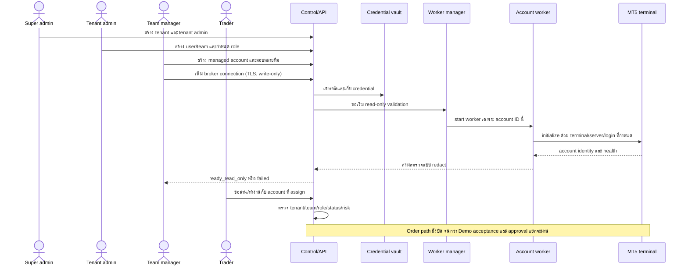

# ข้อเสนอ: ผู้ใช้ ทีม และหลายบัญชีโบรกเกอร์

เอกสารนี้กำหนดขอบเขตสำหรับเพิ่ม platform super admin, tenant/team users, managed subaccounts และ broker accounts หลายบัญชี โดยไม่ถือว่าระบบปัจจุบันรองรับการใช้งานเหล่านี้แล้ว

## Policy และสถานะ Implementation

ข้อกำหนดด้านล่างคือ policy เป้าหมายสำหรับการพัฒนา ไม่ใช่การรับรองว่า runtime รองรับครบแล้ว:

- เก็บ broker login/password แยกต่อ broker account ใน vault; ห้ามใส่ `.env`, YAML, source, command line หรือ log. Master key เป็นคนละ secret กับ broker credential และต้อง provision/backup/rotate ผ่านกลไกที่อนุมัติ.
- ก่อน assign เจ้าของหลักควบคุมบัญชีได้; หลัง assign ผู้รับมอบหมายควบคุมตาม role ส่วนเจ้าของดู progress ได้อย่างเดียว. การย้าย/คืน assignment ต้องผ่านผู้มีสิทธิ์ บันทึก audit และตรวจ worker/สถานะงานก่อนคืน control ให้ owner.
- Super admin จัดการ tenant เท่านั้น; ห้ามเห็น/อ่าน/ส่งออก secret และไม่มีสิทธิ์ควบคุมการเทรด.
- แยก control plane (tenant, identity, RBAC, assignment, audit) ออกจาก trading plane ที่แยก worker, risk, exposure, kill switch, idempotency และ reconciliation ต่อ account. ห้าม mirror คำสั่งข้ามบัญชีโดยปริยาย; ต้องมี system-wide kill switch ด้วย.
- บัญชี Demo และ Live ของ broker เดียวกันเป็นคนละ account/credential record; ห้ามใช้ credential ร่วมกันหรือ fallback ไป login/server อื่น.

รายการ implementation ด้านล่างเป็น local worktree evidence จนกว่าจะถูกรวมและทดสอบใน branch เป้าหมาย:

- มี schema `tenants`, `teams`, `team_members` และ `broker_accounts`; ผู้ใช้เดิมถูก backfill เข้า tenant `default` โดยไม่เปลี่ยน workspace/database ownership
- Platform super admin แยกด้วย `platform_role` ไม่ใช่ trading role; bootstrap ผ่าน `python -m services.api_gateway.bootstrap_platform_super_admin` ซึ่งรับ password แบบ hidden prompt และไม่แก้/อ่าน `.env`
- API `POST/GET /api/platform/tenants` สร้าง tenant พร้อม tenant admin; `PATCH /api/platform/tenants/{id}` ระงับ/เปิด tenant; user CRUD และ account/team queries จำกัดด้วย tenant ID
- tenant ใหม่ยังถูกปฏิเสธจาก shared trading REST/WebSocket runtime จนกว่าจะมี worker/database isolation; นี่เป็น guard ป้องกันข้อมูลข้าม tenant ไม่ใช่สถานะพร้อมใช้งานเทรด
- `POST /api/broker-accounts` เก็บ account ต่อรายการและคืนเฉพาะ masked login; credentials เข้ารหัส AES-GCM ผูก associated data กับ account ID และมี HMAC fingerprint กัน duplicate
- `NO7_CREDENTIAL_VAULT_KEY` เป็น master key ที่ต้องส่งจาก OS/secret manager เข้าสู่ process environment; **ไม่ใช่ broker login/password** และห้ามเก็บ key นี้หรือ broker credentials ใน `.env` ที่ commit/แชร์
- Demo connection สร้างเป็น `pending_validation`; Live สร้างเป็น `live_disabled`; ทุก record เริ่ม `execution_enabled=false`
- `.env.example` ไม่มี `MT5_LOGIN`, `MT5_PASSWORD` หรือ `MT5_SERVER`; `BrokerRegistry` ไม่อ่าน account credential จาก global ENV อีกต่อไป
- UI ปัจจุบันมี platform tenant control, team membership และ managed broker-account form/list/assignment; Broker Manager ซ่อน YAML runtime profile สำหรับ tenant ใหม่และ super admin ไม่มี broker access
- assignment ใช้ `assignment_version` แบบ compare-and-swap; คำขอเก่าถูกปฏิเสธเพื่อไม่ให้สองทีมได้ control พร้อมกัน
- มี one-shot Demo validator ใน subprocess: ตรวจ terminal ที่ operator เปิด/login ไว้แล้วว่าตรง login/server/type และอ่าน quote; ผ่านแล้วจึงเป็น `ready_read_only`, โดย `execution_enabled` ยังคง false
- Demo validator ไม่ใช้/ไม่ยืนยัน password ที่บันทึกใน vault และไม่ส่งคำสั่ง; credential rotation/revocation, persistent per-account MT5 worker, account-level execution และ Demo order acceptance ยังไม่พร้อม
- `scripts/check-mt5-demo.ps1` ยังคงเป็น manual read-only diagnostic; ไม่ใช่หลักฐานว่า order path ของระบบผ่าน Demo trade test
- regression slice ล่าสุด: tenant/account/role/vault/local-env tests ผ่าน `37/37`; มี Starlette TestClient deprecation warning 1 รายการ ผลนี้ไม่ใช่ MT5 terminal หรือ Demo order acceptance

## สถานะปัจจุบัน

- มี role `admin`, `trader`, `viewer` และ API สำหรับ admin สร้าง/แก้ไข/ปิดผู้ใช้ แต่ทุกคนอยู่ใน users table และ workspace เดียวกัน
- Broker profile ปัจจุบันมาจาก `config/brokers.yaml`; ก่อนเริ่มงานนี้มี legacy `MT5_LOGIN/PASSWORD/SERVER` ใน env example แต่ registry ถูกแก้ให้ไม่อ่าน credential ชุด global แล้ว
- Broker manager เลือก active broker ได้ครั้งละหนึ่งตัว และ `TradingRuntime`/position management ใช้ adapter ที่ active อยู่
- MT5 Python package ใช้ terminal connection แบบ process-global จึงไม่ควรสร้าง adapter หลายตัวใน process เดียวแล้วสมมติว่าแต่ละ adapter แยก session กัน
- `Connext (Demo)` ปัจจุบันเป็น simulator; MT5 profile ไม่ได้แปลว่ามีการล็อกอินหรือผ่าน broker acceptance แล้ว ส่วน live profile ยังปิด `live_allowed`
- โบรกเกอร์หนึ่งรายอาจมี Demo และ Live หลาย login/server; แต่ละชุดเป็น `broker_connection` คนละ record และคนละ credential ห้ามอนุมานชนิดบัญชีจากชื่อ profile หรือใช้ credential ชุดเดียวสลับ environment
- `run.py` และ `scripts/run-local.ps1` เป็น local simulated/paper launchers ไม่ใช่ multi-account MT5 launcher

## ค่าเริ่มต้นที่เลือก

1. แต่ละ broker account ทำงานแยก risk state, position state, database scope และ worker; ไม่ mirror สัญญาณหรือคำสั่งข้ามบัญชีโดยอัตโนมัติ
2. `super_admin` จัดการ tenant และผู้ดูแล tenant ได้ แต่ไม่เห็นรหัสผ่าน/secret ของบัญชีโบรกเกอร์หลังบันทึก และไม่มีสิทธิ์ควบคุมการเทรด
3. `managed subaccount` เป็น record ที่ทีมดูแล ไม่ใช่ user principal และไม่มี password หรือ login เข้าระบบ
4. เจ้าของหลักควบคุมบัญชีของตนได้เต็มตาม role ขณะที่บัญชียังไม่ถูก assign; หลัง assign ให้ manager/team สิทธิ์ควบคุมย้ายไปผู้รับมอบหมาย เจ้าของหลักดู progress ได้อย่างเดียว
5. Broker credentials แยกเก็บต่อ account ใน credential vault ไม่เก็บใน `.env`, YAML หรือ source code
6. เปิดรับบัญชี Demo และตรวจสถานะแบบ read-only ก่อน; live execution ต้องปิดไว้จนกว่าจะมี acceptance และอนุมัติแยก

## แบบจำลองเป้าหมาย

### Identity และ tenancy

- `tenant`: ลูกค้า/องค์กรและขอบเขตข้อมูลหลัก
- `user`: identity สำหรับล็อกอิน ผูกกับ tenant; role อย่างน้อย `tenant_admin`, `manager`, `trader`, `viewer`
- `super_admin`: role ระดับ control plane สำหรับสร้าง/ระงับ tenant และ bootstrap tenant admin; ห้ามใช้แทน tenant role ในคำขอปกติ
- `team`: กลุ่มผู้ใช้ภายใน tenant สำหรับกำหนดผู้ดูแลบัญชี
- การสร้าง tenant เริ่มจาก `primary_owner`/`tenant_admin`; บัญชี broker ที่เพิ่มภายหลังมี `owner_user_id` และสถานะการมอบหมายของตัวเอง ไม่ใช้ login ของ managed account เป็น login ของแอป
- ทุก API, WebSocket, query และ audit event ต้องมี tenant scope จาก identity ฝั่ง server ห้ามเชื่อ tenant/account ID ที่ client ส่งมาเพียงอย่างเดียว

### บัญชีโบรกเกอร์และบัญชีย่อย

- `managed_account`: record ที่ไม่ต้องล็อกอิน เก็บ label, tenant, team/assignee, status และ metadata ที่ไม่ลับ
- `managed_account` เก็บ `owner_user_id` ผู้สร้าง/เจ้าของหลัก และ `assignment_state` ว่างหรือ assigned; `assigned_team_id`/`assigned_manager_id` ระบุผู้ควบคุมปัจจุบัน
- `broker_connection`: ข้อมูล connection ของ broker account เช่น provider, server, account type, masked login และสถานะการตรวจสอบ โดยหนึ่งบัญชีเก็บ credentials ของตัวเอง ไม่แชร์ ENV credentials ข้าม account
- `account_type` เป็น enum ที่ตรวจจาก broker/terminal (`demo` หรือ `live`) และต้องตรงกับค่าที่ owner เลือกตอนเพิ่ม; Demo/Live ของ provider เดียวกันมีคนละ connection ID, credential, worker, risk state และ approval record
- connection ที่ตรวจพบว่าเป็น Live แต่ถูกลงทะเบียนเป็น Demo (หรือกลับกัน) ต้อง fail closed; แก้ด้วยการสร้าง/แก้ connection ภายใต้ approval และ audit ไม่เปลี่ยน type เงียบ ๆ ตอน runtime
- รหัสผ่านและ credential ต้องเข้ารหัสก่อน persist ด้วย key จาก OS secret store/KMS หรือ secret manager ภายนอก; key สำหรับเข้ารหัสไม่ใช่ broker credential และไม่ควรเก็บรวมใน `.env` ของแอป
- API ตอบกลับได้เฉพาะ masked value/metadata และห้าม log credential; ห้ามส่ง secret ผ่าน query string, browser storage หรือ command line
- การเปลี่ยน credential เป็น write-only; การอ่าน health หรือ symbol specs ต้องไม่ส่ง secret กลับ browser
- subaccount ที่ไม่มี login ไม่สามารถยืนยันตัวตนหรือเรียก API เองได้; สิทธิ์มาจาก tenant/team membership ของผู้ใช้จริง

### สิทธิ์ตามการมอบหมายบัญชี

การ assign เป็นการโอน **สิทธิ์ควบคุม** ไม่ใช่การโอน ownership หรือ credentials. เจ้าของหลักยังเห็น progress, health, position summary และ audit ที่อนุญาต แต่เมื่อ assign แล้วจะสั่ง start/stop, เปลี่ยน broker connection/risk, ส่ง/แก้/ปิดคำสั่ง หรือ assign ต่อเองไม่ได้

| สถานะบัญชี | เจ้าของหลัก | ผู้ดูแล/ทีมที่รับมอบหมาย | Tenant admin | Super admin |
|---|---|---|---|---|
| ยังไม่ assign | ควบคุมบัญชีตนเองตาม role | ไม่มีสิทธิ์ | จัดการสมาชิก/นโยบาย แต่ไม่เทรดแทน | จัดการ tenant เท่านั้น |
| assign ให้ manager/team | ดู progress แบบ read-only | ควบคุมได้ตาม role ที่ได้รับ | เปลี่ยน assignment ได้ตาม policy และมี audit; ไม่ส่งคำสั่งเทรด | จัดการ tenant เท่านั้น ไม่ควบคุมบัญชี |
| paused/disabled | ดูสถานะที่อนุญาต | ไม่มีคำสั่งใหม่; อ่านประวัติได้ตามสิทธิ์ | จัดการ lifecycle/assignment | จัดการ tenant เท่านั้น |

ก่อน assign ระบบต้องตรวจว่า manager/team อยู่ใน tenant เดียวกัน มีสมาชิกและ role ที่เหมาะสม และไม่มี assignment ซ้อน จากนั้นเปลี่ยน assignment แบบ atomic พร้อมเพิ่ม `assignment_version`/epoch เพื่อเพิกถอน session สิทธิ์เก่า การเปลี่ยน assignment มีผู้กระทำ เหตุผล เวลา และค่า before/after ใน audit

การถอดหรือย้าย assignment ทำได้โดย tenant admin หรือผู้มี assignment-management permission; ต้อง block คำสั่งใหม่, หยุด/ระบายงาน worker, reconcile สถานะก่อนปล่อยให้ owner ควบคุมกลับ เจ้าของหลักขอคืนบัญชีได้ แต่ request อย่างเดียวไม่เปลี่ยนสิทธิ์จน workflow สำเร็จ

### Runtime หลายบัญชี

- ให้มี account worker แยกต่อ broker connection; MT5 หนึ่ง worker ต่อหนึ่ง terminal/session เพื่อลดการชนกันของ process-global MT5 API
- worker ต้องตรวจ account number/server ที่เชื่อมจริงให้ตรงกับ credential/profile ก่อนรายงาน connected หรือรับงาน
- แต่ละ worker มี risk limits, kill switch, order/idempotency scope, reconcile state และ audit trail ของบัญชีนั้นเอง
- control plane ส่งเฉพาะคำสั่งที่มี account scope ชัดเจน; ห้าม fallback ไป active account อื่นเมื่อ connection ขาดหรือ identity ไม่ตรง
- การเปิดหลายบัญชีพร้อมกันเริ่มจาก read-only Demo acceptance ก่อน; การส่งคำสั่งทุกบัญชีพร้อมกันเป็น feature แยกที่ต้องมี opt-in และ test สำหรับ partial failure

## หลักการทำงานโดยละเอียด

### ผู้ใช้และขอบเขตสิทธิ์

1. `super_admin` เข้าระบบ control plane เพื่อสร้าง/ระงับ tenant และสร้าง `tenant_admin` คนแรก ไม่มี public signup และไม่มีการใช้บัญชี super admin เป็นบัญชีเทรด
2. `tenant_admin` สร้างผู้ใช้ภายใน tenant, กำหนด role และสร้างทีม; ทำได้เฉพาะข้อมูล tenant ของตน
3. `manager` ดูแลทีมและ assign managed account เฉพาะที่ tenant อนุญาต; ไม่เห็น broker password
4. `trader` ใช้บัญชีที่ได้รับมอบหมายได้ตาม policy ของบัญชีนั้น; `viewer` อ่านสถานะได้อย่างเดียว
5. managed subaccount เป็นแค่ resource ที่มีชื่อ/ทีม/owner/status ไม่มี email, password, JWT หรือ session; ผู้ใช้จริงเป็นผู้กระทำทุกครั้งและถูกบันทึกใน audit

ทุก API/WebSocket เริ่มจากยืนยัน user จาก token แล้วโหลด tenant/role/assignments จากฐานข้อมูลฝั่ง server จากนั้นจึงตรวจสิทธิ์กับ resource ID ที่ร้องขอ ห้ามรับ `tenant_id` จาก browser มาเป็น authority และต้องใส่ tenant scope ใน query, cache key, export, notification และ audit ด้วย

### เพิ่มบัญชีโบรกเกอร์

1. เจ้าของหลักหรือผู้มีสิทธิ์สร้าง managed account และเป็น owner ของ record ระบุ provider, account type (`demo`/`live`), server, login และ label; ถ้ามี Demo กับ Live ต้องสร้างสอง record แยกกันและใส่ credential ของแต่ละ login แยกกัน
2. ก่อน assign บัญชีอยู่ใน owner-control mode; owner ทำงานกับบัญชีของตนที่ยังไม่ assign ได้เต็มตาม role
3. หน้าเว็บส่ง password ผ่าน TLS ไป API แบบ write-only; API ไม่ echo ค่าเดิมกลับ ไม่เก็บใน `.env`, YAML, browser storage, URL, log หรือ audit detail
4. API ตรวจสิทธิ์ tenant/owner และรูปแบบ input ก่อนให้ credential vault เข้ารหัส secret ด้วย key ภายนอก DB; เก็บเฉพาะ ciphertext, key version และ metadata ที่จำเป็น
5. connection เริ่มสถานะ `pending_validation` และยังไม่มีสิทธิ์ส่งคำสั่ง การตรวจครั้งแรกเปิด worker แบบ read-only เพื่อเช็ค terminal, server, login และ account type ที่เชื่อมจริงให้ตรงกับที่กำหนด; การยืนยัน Demo ไม่อนุมัติหรือเปิด Live connection ใด ๆ
6. ถ้า identity ไม่ตรงหรือ terminal ใช้ไม่ได้ ให้สถานะเป็น `failed`/`disconnected`, บันทึก error ที่ redact แล้ว และปิด worker; ห้ามลองบัญชีอื่นหรือ fallback ไป active broker
7. เมื่อผ่าน จะเป็น `ready_read_only`; owner ควบคุม worker ได้ตราบใดที่ยังไม่ assign
8. เมื่อ assign ให้ manager/team ระบบยืนยัน assignment แบบ atomic, เพิ่ม assignment epoch และย้าย control permission ไปผู้รับ; owner เปลี่ยนเป็น observer ทันที

การเพิ่ม managed subaccount ที่ไม่มี broker credential ทำเฉพาะขั้นสร้าง resource และมอบหมายทีม ไม่สร้าง connection หรือ worker จนกว่าจะผูก broker account จริง

### รันหลายบัญชีพร้อมกัน

Control plane เก็บ desired state, owner และ assignment ของแต่ละ connection ส่วน worker manager ทำหน้าที่ start/stop และรายงาน health. การสั่งงาน worker ต้องผ่าน authorization ของ API; การรู้ worker/account ID ไม่ทำให้ควบคุมได้. แต่ละ connection มี worker และ MT5 terminal/session แยกกัน เพราะ MT5 Python API มี process-global state; ห้ามแชร์ instance เดียวแล้วสลับ login ระหว่างรอบทำงาน

worker แต่ละตัวมี account ID คงที่และพื้นที่แยกสำหรับ database/positions, risk limits, kill switch, idempotency keys, reconciliation และ logs. การเปลี่ยน account ในหน้า UI เป็นเพียงการเลือก resource; backend ต้องตรวจ owner/assignment ใหม่ทุก action. owner ที่บัญชียังไม่ assign ควบคุมได้ตาม role; owner ของบัญชีที่ assign แล้วดู progress ได้เท่านั้น ส่วน manager/team ที่ได้รับ assignment ควบคุมได้ตาม role. ไม่มีสิทธิ์ใดข้าม tenant

ค่าเริ่มต้นคือ independent mode: signal, action หรือ failure ของ account A ไม่ถูกส่งไป account B. ถ้าภายหลังเพิ่ม strategy mirroring ต้องเป็น opt-in แยก มี preview รายบัญชี, ตรวจ risk แยก, แสดงผล partial success และมี kill switch ต่อ account; ห้ามตีความการส่งคำสั่งเป็น atomic transaction ข้าม broker

### วงจรข้อมูลและการสั่งงาน

ในระยะแรก worker รับข้อมูล account/terminal แบบ read-only และส่ง health/specs กลับ control plane. เมื่อผ่าน Demo acceptance แล้วเท่านั้นจึงเปิด account-scoped execution path ตามลำดับนี้:

1. API ยืนยัน user, tenant, team assignment, assignment epoch, account status และ permission สำหรับ action; assignment เปลี่ยนแล้ว token เก่าไม่คงสิทธิ์ควบคุม
2. API สร้าง request ที่ผูก `tenant_id`, `account_id`, actor และ idempotency key จาก server-side identity
3. risk gate ของบัญชีนั้นตรวจ limits, exposure, freshness, symbol specs และสถานะ reconciliation; ไม่ใช้ค่า risk หรือ positions ของบัญชีอื่น
4. worker ยืนยัน server/login ปัจจุบันซ้ำก่อนส่ง adapter call; identity เปลี่ยนหรือข้อมูล stale ให้ fail closed
5. worker ส่งคำขอครั้งเดียวตาม idempotency/reconciliation policy แล้วบันทึกผล, broker reference และ audit event ที่ไม่รวม secret
6. API แสดงผลและสถานะให้ผู้มีสิทธิ์ใน tenant เดียวกัน; action ที่กำกวมต้องหยุดและ reconcile ก่อน retry

การเปิด `ready_read_only` ไปสู่ `execution_enabled` ต้องมี approval/audit แยกจากการบันทึก credential และยังปิดไว้เป็นค่าเริ่มต้น; เอกสารนี้ไม่ได้เปิด live account หรืออนุญาตให้ส่งคำสั่ง

### การจัดการเมื่อผิดพลาด

- **worker หนึ่งขาดการเชื่อมต่อ:** ระงับเฉพาะ account นั้น, mark health stale/disconnected และหยุด action ใหม่; worker อื่นทำงานต่อได้โดยไม่เปลี่ยน state
- **login/server mismatch:** ปิด worker ทันที, ไม่ retry ด้วย credential อื่น, แจ้งผู้ดูแลด้วยข้อความที่ไม่เผย secret และต้องให้คนแก้ข้อมูล/ยืนยันใหม่
- **API/worker restart:** อ่าน desired state แล้วตรวจ identity และ broker positions ใหม่ก่อนรับงาน; ห้าม replay คำสั่งที่สถานะไม่ชัด
- **ยกเลิก/ปิด managed account:** block งานใหม่ก่อน, drain หรือหยุด worker, revoke การเข้าถึง credential, เก็บ audit/history ตาม retention policy; ห้ามลบประวัติทางการเงินตาม cascade โดยไม่ตรวจนโยบายเก็บข้อมูล
- **ผู้ใช้ถูกปิดหรือถอดจากทีม:** token/assignment มีผลตาม policy ทันที; worker ไม่ได้เป็นเจ้าของสิทธิ์และยังต้องตรวจ actor ผ่าน API ทุกคำสั่ง
- **บัญชีถูก assign ระหว่างมีหน้าเปิดอยู่:** API ปฏิเสธ mutation ของ owner ทันทีด้วยสถานะ forbidden/conflict; progress stream คงเป็น read-only และ UI ต้อง refresh assignment state
- **ขอคืนบัญชีจากทีม:** account คงสถานะ assigned จนผู้มีสิทธิ์อนุมัติ, worker หยุดรับคำสั่งใหม่และ reconcile; จึงค่อยเปลี่ยนกลับเป็น owner-control mode

### ภาพรวม flow



## ลำดับการพัฒนา

1. **Identity/control plane:** ส่วน bootstrap, tenants, tenant-scoped user CRUD และ baseline cross-tenant guards เริ่ม implement แล้ว; ยังต้องเพิ่ม provisioning lifecycle, recovery และ review การแยก public/runtime routes
2. **ทีมและ managed accounts:** schema/service/API เบื้องต้นสำหรับ teams, membership, broker records และ assignment เริ่มแล้ว; ยังต้องเพิ่ม UI, revoke/reassignment workflow และ regression รอบ concurrent assignment
3. **Credential vault และ Demo connection:** AES-GCM storage/tenant-bound API เริ่มแล้ว; ยังต้องกำหนด production secret-manager integration, key rotation/backup, credential update/revoke และ MT5 read-only identity validation
4. **Account workers:** ยังไม่เริ่ม; ต้องแยก MT5 terminal/session ต่อบัญชี, database/risk/execution scope และ supervisor lifecycle; ทดสอบ disconnect, mismatch, restart, duplicate request และ partial worker failure
5. **Operations/acceptance:** ยังไม่เริ่ม; audit/monitoring, backup/restore, permission review และ Demo acceptance หลายบัญชีก่อนพิจารณา live policy แยกต่างหาก

### เตรียม local control-plane

สร้าง platform super admin ครั้งแรกจาก repository root โดยหยุด app ก่อนและใช้ virtualenv:

```powershell
.\.venv\Scripts\python.exe -m services.api_gateway.bootstrap_platform_super_admin
```

คำสั่งถาม email/password ใน terminal และไม่พิมพ์ password ออกมา จากนั้น login ผ่านหน้าเว็บ/API ตามปกติ ค่า broker login/password ต้องกรอกใน managed-account API/UI เมื่อส่วน UI เสร็จ; master key `NO7_CREDENTIAL_VAULT_KEY` ให้ provision แยกผ่าน process environment/secret manager และสำรองอย่างปลอดภัย หากไม่มี key ระบบต้องปฏิเสธการบันทึก credential

## เกณฑ์รับงานสำคัญ

- tenant หนึ่งอ่าน แก้ไข หรือสั่งงานข้อมูลของ tenant อื่นไม่ได้ รวมถึง WebSocket และ export/history routes
- ผู้ใช้ที่ไม่มีสิทธิ์ไม่สามารถสร้าง user, เปลี่ยน role, เปลี่ยน credential หรือ assign account ให้ทีมอื่น
- managed subaccount ไม่มี login และไม่ถูกนับเป็น identity สำหรับ JWT/session
- DB/API/log/browser storage ไม่มี broker password เป็น plaintext; การลบ/ปิดบัญชี revoke worker และ credential access ได้
- account workers เชื่อม server/login ที่ตั้งใจไว้เท่านั้น; mismatch ต้อง fail closed และไม่มีการส่งคำสั่ง
- ความล้มเหลวของ account หนึ่งไม่เปลี่ยน active adapter, risk state หรือ position state ของอีกบัญชี
- tests ครอบคลุม cross-tenant denial, role escalation, credential redaction, account mismatch, worker isolation และ migration จากข้อมูลเดิม

## ข้อจำกัดของเอกสารนี้

นี่เป็น design baseline ไม่ใช่ implementation หรือการรับรอง MT5/Connext. จนกว่าแต่ละ phase จะผ่าน acceptance ให้ใช้ `run.py` ใน simulated/paper mode เท่านั้น และอย่าใส่ credential จริงลงใน YAML, source code, issue หรือแชต
